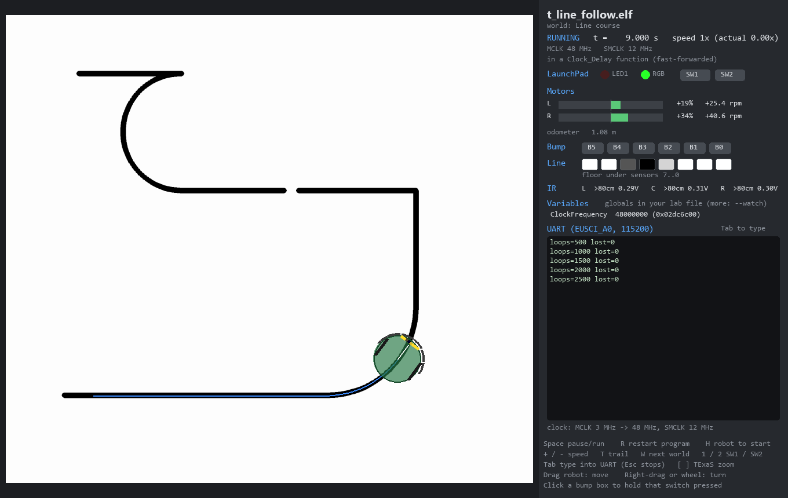

# TI-RSLK MAX robot simulator

**Test your TI-RSLK MAX robot code at home, without the robot.**

`rslk-sim` runs the exact `.out` file that Code Composer Studio (CCS) builds for the
TI-RSLK MAX (MSP432P401R LaunchPad) on an emulated microcontroller wired to a 2D
simulated robot. You can watch the robot drive on a track, press its buttons and bump
switches, type into its UART, watch your variables live and debug with breakpoints,
as you would on the real hardware.



```
your C code --CCS build--> Lab.out --> [ Cortex-M4 emulator + MSP432 peripherals ] --> 2D robot world
                                          (Unicorn)    GPIO, Timer_A, SysTick,         motors, wheels, encoders,
                                                       ADC14, UART, NVIC, ...          line sensor, bumpers, IR
```

Your code doesn't need to change, and you don't need a special build. The emulator executes
the real ARM instructions and models the hardware registers that the TI-RSLK `inc/` drivers
and your lab code use.

> **Status:** early (v0.1). It runs TI's RSLK MAX self-test and the bundled test programs
> correctly, but the course labs have not all been tested yet. Bug reports are welcome:
> please open an issue with the `.out` file (if you can share it) and what you expected.

## Contents

- **Getting started:** [Features](#features) · [Requirements](#requirements) · [Installation](#installation) · [Quick Start](#quick-start)
- **Using it:** [Controls](#using-the-window) · [Worlds](#worlds) · [Headless Mode](#headless-mode) · [Debugging](#debugging-with-gdb-or-vs-code)
- **Reference:** [Simulation Models](#simulation-models) · [Accuracy and Limits](#accuracy-and-limits) · [Development](#development) · [Acknowledgements](#acknowledgements-and-disclaimer)

## Features

- **Runs unmodified CCS builds.** It runs TI-compiler (`ti-cgt-arm`) and GCC ELF files,
  including the C run-time startup, interrupts and the FPU.
- **Simulated robot.** Motors with PWM or software PWM, wheel encoders, the 8-channel QTRX
  line sensor, six bump switches, Sharp IR distance sensors and the Nokia 5110 LCD.
- **Live variables.** The globals and `static`s in your own lab file are shown as they
  change, like CCS's Expressions window.
- **TExaS support.** `TExaS_Init(LOGICANALYZER_Px)` and `TExaS_Init(SCOPE)` streams are
  drawn as logic-analyzer or scope traces, like TExaSdisplay.
- **Source-level debugging.** A built-in GDB server works with the gdb that ships with CCS,
  or VS Code (F5). It supports breakpoints, stepping, backtraces through interrupt handlers
  and `monitor reset`.
- **Readable errors.** Faults name the C source line, for example a NULL pointer, an
  interrupt enabled without a handler, a watchdog reset or `main()` returning.
- **Simulated time.** Timing-dependent code behaves correctly even when the PC runs the
  emulator slower than real time. Most programs run at 1x to 14x real time.

## Requirements

- Python 3.9 or newer (Windows, macOS or Linux)
- A program built for the TI-RSLK MAX, usually with Code Composer Studio
- Optional: CCS's `arm-none-eabi-gdb` for debugging, and CCS's GCC to build the test programs

## Installation

```
git clone https://github.com/<your-username>/rslk-sim.git
cd rslk-sim
python -m pip install -e .
```

This installs [`unicorn`](https://www.unicorn-engine.org/),
[`pyelftools`](https://github.com/eliben/pyelftools) and
[`pygame-ce`](https://pyga.me/), and makes `python -m rslk_sim` (or the `rslk-sim`
command) work from any folder.

## Quick start

1. **Build in CCS as usual** (hammer icon). CCS writes the program to
   `<project>\Debug\<project>.out`, for example `Lab2_FSM\Debug\Lab2_FSM.out`. You don't
   need to press "Debug" or flash anything.
2. **Run it:**
   ```
   python -m rslk_sim Lab2_FSM\Debug\Lab2_FSM.out --world line_course
   ```
   On Windows you can also drag the `.out` file onto `rslk_sim.bat`, or double-click
   `rslk_sim.bat` to choose a file.
3. **Rebuild in CCS while the window is open.** A banner appears; press **R** to load the
   new build.

## Using the window

| Key / mouse | Action |
|---|---|
| Space | pause / run |
| R | restart the program (reloads the `.out` if it was rebuilt; the robot stays put) |
| H | put the robot back at the world's start position |
| + / - | simulation speed (0.1x ... 10x, max) |
| W | switch to the next world |
| T | trail on / off |
| 1 / 2 (hold) | press LaunchPad SW1 / SW2 |
| Tab | type into the UART console (Enter sends `\r`, Esc stops typing) |
| [ / ] | zoom the TExaS logic analyzer / scope view (2 ms ... 500 ms) |
| drag robot | move it; right-drag or mouse wheel turns it |
| click B0..B5 | hold a bump switch pressed (click again to release) |

The side panel shows:

- the LaunchPad LEDs and switches
- motor duty, wheel RPM and the odometer
- bump switches
- the floor under the 8 line sensors
- IR distances and voltages
- the Nokia 5110 screen (if your program uses it)
- **Variables.** These are the global and `static` variables in your own source files (for
  example `reflectance_data`, `bump_data`). 8-bit values also show hex and binary, so bit
  patterns are easy to read. Add any other global with `--watch NAME`; a `static` inside a
  function is `FUNCTION.NAME`.
- **TExaS.** These are logic-analyzer traces or the scope trace, when your program uses
  TExaS.
- **UART.** This is the EUSCI_A0 output at 115200 baud, which is what a serial terminal
  would show.

## Worlds

```
python -m rslk_sim --list-worlds
```

| World | Use it for |
|---|---|
| `line_oval` | line following (the robot starts on the line) |
| `line_course` | FSM line following: curves, a sharp corner, a gap and a dead end |
| `line_straight` | speed, odometry and steering tests |
| `wall_arena` | bump switches and IR distance sensors |
| `corridor_loop` | wall following with IR sensors (a corridor with a centre line) |
| `maze` | wall following and bump recovery |

Worlds are small JSON files in [`worlds/`](worlds). To build your own track, copy one and
edit the line points, walls and start pose. [`tools/make_worlds.py`](tools/make_worlds.py)
shows how the bundled ones are generated. You can also use a floor image:
`"image": {"file": "track.png", "meters_per_pixel": 0.001}`.

## Headless Mode

Run without a window for quick checks, with UART output printed in the terminal:

```
python -m rslk_sim Lab5_UARTComms\Debug\Lab5_UARTComms.out --headless --sim-time 5 --uart "1:hello\r"
python -m rslk_sim Lab3\Debug\Lab3.out --headless --world wall_arena --press BUMP2@1-1.5 --press SW1@2-2.2
```

At the end, a headless run prints your variables. For TExaS programs it also prints
statistics for each logic-analyzer channel (percent of time high, edges per second).

| Option | Meaning |
|---|---|
| `--sim-time S` | seconds of robot time to simulate (default 5) |
| `--uart "[T:]TEXT"` | type TEXT into the UART at time T (default 0.5 s); repeatable |
| `--press NAME@T1-T2` | hold `SW1`, `SW2` or `BUMP0`...`BUMP5` from T1 to T2 seconds; repeatable |
| `--watch NAME[,NAME]` | also show these variables |
| `--watch-every S` | print the watched variables every S seconds |
| `--texas-csv FILE` | save TExaS samples to a CSV file (for example to plot in Excel) |
| `--quiet` | print only the UART output |

Run `python -m rslk_sim --help` for all options.

## Debugging with gdb or VS Code

Start the simulator with a GDB server (port 3333 by default):

```
python -m rslk_sim Lab2_FSM\Debug\Lab2_FSM.out --world line_course --gdb
```

The window waits for a debugger to connect.

**VS Code (recommended).** Install the *C/C++* extension (`ms-vscode.cpptools`). Copy the
two files from [`vscode_template/`](vscode_template) into `<your project>\.vscode\`, open the
project folder in VS Code and press **F5**. VS Code starts the simulator window and
attaches to it. If CCS isn't installed in `C:\ti\ccsv7`, edit `miDebuggerPath` in
`launch.json`.

**gdb in a terminal**, using the gdb that ships with CCS:

```
C:\ti\ccsv7\tools\compiler\gcc-arm-none-eabi-6-2017-q1-update\bin\arm-none-eabi-gdb.exe Lab2_FSM\Debug\Lab2_FSM.out
(gdb) target remote localhost:3333
(gdb) break Motor_Forward
(gdb) continue
(gdb) bt                 # backtrace (works through interrupt handlers)
(gdb) next / step / finish
(gdb) print Data         # any variable
(gdb) x/1xb 0x40004C21   # read a register by address (here P4->IN)
(gdb) monitor reset      # restart the program
```

Don't use gdb's `load` command. The simulator has already loaded the program.

## Simulation Models

| Part | Model |
|---|---|
| CPU | Cortex-M4F (Thumb-2 + FPU), NVIC with priorities and nesting, WFI sleep, SysTick, faults |
| Clocks | CS / PCM / flash wait states; `Clock_Init48MHz` really switches MCLK to 48 MHz and SMCLK to 12 MHz |
| GPIO P1-P10, PJ | DIR/OUT/IN/REN pull-ups/SEL, edge interrupts with PxIES/PxIFG/PxIV, bit-band access |
| Timer_A0-A3 | up / continuous / up-down, compare flags and interrupts, TAxIV, input capture (tachometer), PWM outputs |
| Timer32, ADC14, eUSCI | periodic timers; single / sequence / repeat conversions; UART (with correct TXIFG/RXIFG timing) and SPI |
| Watchdog | resets your program if it is left running, as on the real chip |
| Motors | DRV8838 drivers (PWM/DIR/nSLEEP), from timer PWM or software PWM (GPIO toggling) |
| Robot | 70 mm wheels, 14.1 cm track, first-order motor response with a friction dead band; wheels stall against walls |
| Encoders | 360 pulses per wheel turn; A channels on P10.4/P10.5 (TA3 capture), B channels on P5.0/P5.2 |
| Line sensor | QTRX 8-channel capacitor-decay timing (white ~0.25 ms, black tape ~2.5 ms), IR LED control P5.3/P9.2 |
| Bump switches | 6 switches on P4 (active low), pressed by walls or by clicking |
| IR sensors | Sharp GP2Y0A21 voltage curve: left A16/P9.1, centre A12/P4.1 and A14/P6.1, right A17/P9.0; 38 ms update |
| LaunchPad | SW1/SW2, red LED, RGB LED; Nokia 5110 LCD on eUSCI_A3 |

The pin map follows the TI-RSLK MAX chassis board v1.0 pinout and the TI-RSLK drivers.
If your robot is wired differently, edit [`rslk_sim/robot/pins.py`](rslk_sim/robot/pins.py).

**Messages you might see:**

- *"... interrupt fired, but the program has no handler"*: you enabled an interrupt
  (e.g. `NVIC->ISER`), but the `xxx_IRQHandler` function name is misspelled or missing.
- *"HardFault: ... (looks like a NULL pointer) at file.c:line"*: the line that crashed.
- *"MCU reset: watchdog timeout"*: your code never stops the watchdog.
- *"... this register is not modelled"*: the register stores values but has no effect.
  Please open an issue if a lab needs it.

## Accuracy and limits

- **Timing.** Instructions are timed at an average of 2 cycles each (`--cpi` changes this).
  - `Clock_Delay1ms`, `Clock_Delay1us` and `delay` from `Clock.c` aren't run instruction by
    instruction. The simulator waits exactly the requested time instead, and interrupts
    still run during the wait.
  - SysTick, Timer_A and UART timing are exact.
  - Busy-wait loops that poll a status flag are fast-forwarded to the moment the flag
    changes (`--no-idle-skip` turns this off).
- **Physics** is a reasonable model, not your exact robot (motor strength, friction, sensor
  noise). Use the simulator for logic, state machines, interrupt handling and getting
  controllers roughly right, then fine-tune gains on the real robot. The constants are in
  `RobotParams` in [`rslk_sim/robot/robot.py`](rslk_sim/robot/robot.py).
- **Not modelled:** flash programming, DMA, low-power modes beyond WFI, I2C sensors, and
  TI driverlib ROM calls (the RSLK labs don't use them).

## Development

```
python -m pip install -e ".[test]"
python tools/build_fw.py     # builds the test programs in fw_tests/ with CCS's GCC
python -m pytest             # peripherals, robot closed loops, TExaS, debugger
```

- The firmware tests need CCS's `gcc-arm-none-eabi`; `tools/build_fw.py` finds it
  automatically. Without it they are skipped.
- `tests/test_selftest.py` runs TI's `RSLK-MAX-SelfTest.out`, which isn't included here.
  To run it, set `RSLK_SELFTEST` to the path of your copy, or put the file in `tests/data/`.

### Code layout

| Path | Contents |
|---|---|
| `rslk_sim/machine.py` | CPU (Unicorn), memory map, exceptions, run loop |
| `rslk_sim/periph/` | MSP432 peripheral models |
| `rslk_sim/robot/` | world, robot physics, sensors, pin map, LCD |
| `rslk_sim/ui.py` | the pygame window |
| `rslk_sim/gdbstub.py` | GDB remote-protocol server |
| `rslk_sim/watch.py` | variables from the DWARF debug info |
| `rslk_sim/texas.py` | TExaS logic-analyzer / scope stream decoder |
| `rslk_sim/regnames.py` | register names, generated by `tools/gen_regnames.py` |
| `fw_tests/` | small C test programs for the simulator |
| `worlds/` | bundled worlds |
| `vscode_template/` | VS Code debug configuration to copy into a CCS project |

## Acknowledgements and disclaimer

- This is an independent student project. It is not affiliated with or endorsed by Texas
  Instruments, Pololu or any university.
- TI-RSLK MAX and MSP432 are trademarks of Texas Instruments. The RSLK curriculum and
  drivers are by Jonathan Valvano and Texas Instruments.
- This repository contains no TI, Pololu or course files. Register names in
  `rslk_sim/regnames.py` are derived from TI's `msp432p401r.h`; see
  [THIRD_PARTY_NOTICES.md](THIRD_PARTY_NOTICES.md).
- The CPU is emulated with the [Unicorn engine](https://www.unicorn-engine.org/).